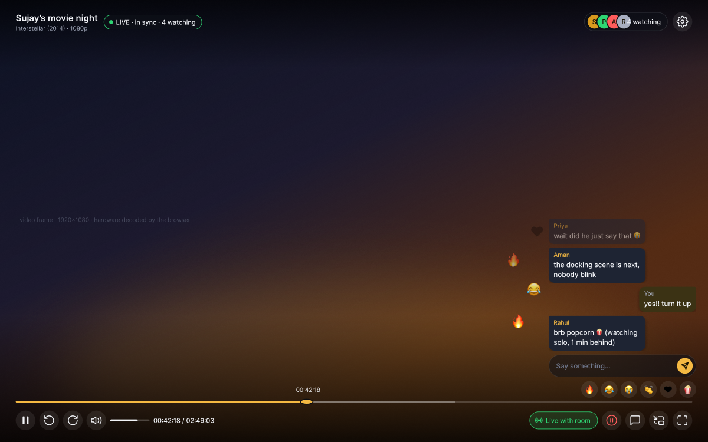
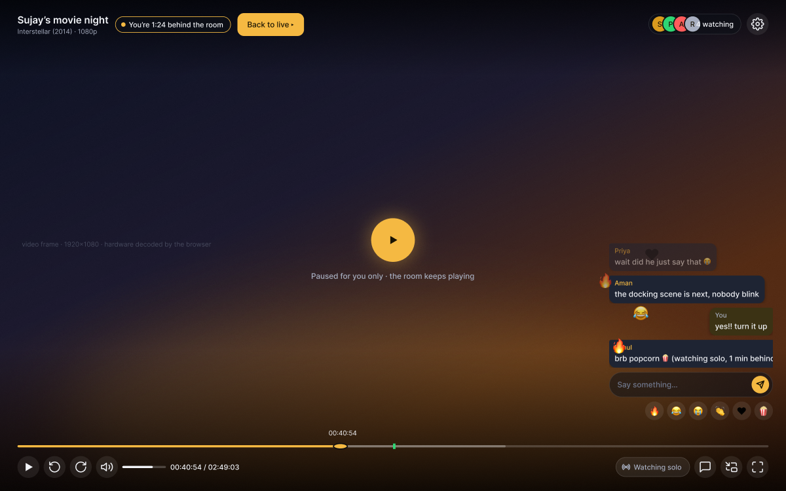
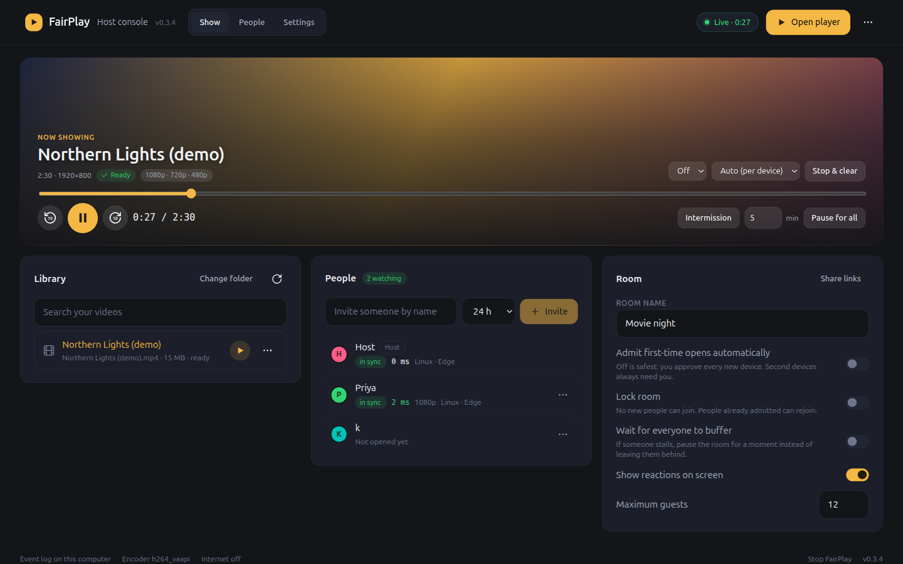
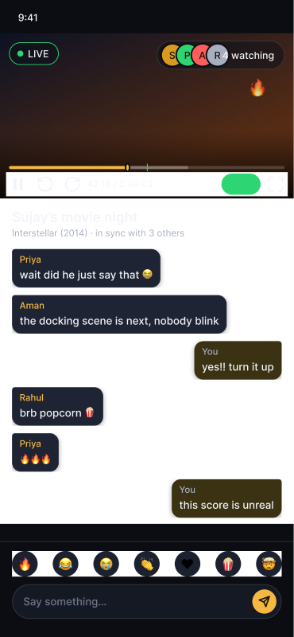

# FairPlay

[](https://github.com/Kumarsujay03/fairplay/actions/workflows/ci.yml)
[](LICENSE)

Watch videos together, perfectly in sync. FairPlay is one small program you run on your own computer. Friends join from any browser, on your Wi-Fi or over the internet. Nothing is uploaded to a server or deployed anywhere.



## Features

- **One global clock.** Everyone sees the same frame at the same moment. Two viewers measured 14–25 ms apart.
- **Watch solo when you want.** Pause or rewind just for yourself, then tap **Back to live** to rejoin the room.
- **Intermission.** The host pauses everyone, with a countdown.
- **Any video file.** MKV, MP4, AVI, HEVC and more are converted by ffmpeg into adaptive quality, up to 1080p. Multiple audio tracks and subtitles are kept, and playback starts while the file is still converting. On Linux with Intel or AMD graphics the conversion runs on the GPU, and ffmpeg always runs at the lowest priority with half the CPU threads, so the host's own player stays smooth.
- **Floating chat and Telegram-style animated reactions.** Pick from more than 600 animated emoji. Each one pops in with a burst and floats up over the chat. Scroll back through the whole chat session. The host can hide chat for any viewer.
- **Your language, your quality.** Tracks are named by language. The host picks audio, subtitles and quality for the room, and anyone can switch to their own. Choose 1080p HD, 720p SD or 480p data saver, or Auto, which gives a laptop 1080p and a phone 720p. The host's own player plays one fixed quality, since it streams from its own computer.
- **Screen lock.** A lock button at the bottom right of the player. While it glows, play, pause, seeking and skipping are frozen, so a phone in a hand can't move the film for everyone; volume, chat and reactions keep working. Chat bubbles show up with each new message and with the controls, and fade after reading time, 5 to 12 seconds depending on the message's length; the text box appears when you move to the chat corner.
- **Volume to 200%.** Like VLC: above 100% the sound is amplified in the browser, for quiet films and quiet laptops.
- **Host console.** A banner with the film and the room's transport, and three cards under it: Library, People and Room. Every person is one row with status, ping and a menu. Tabs for Show, People and Settings.
- **Private by default.** Each person gets a personal invite link, the host admits every new device, and a bot shield protects the public link.
- **Light.** One 8 MB binary that uses about 8 MB of memory.
- **An event log of every showing.** Who was where on the timeline, second by second, every play, pause and seek, the encoder's progress, and what each player saw in its browser. When something stutters, `fairplay logs` says what went wrong.

| Watching solo | Host console | Phone |
|---|---|---|
|  |  |  |

## Install

One command downloads the latest release, checks its checksum, and offers to install ffmpeg and cloudflared if they are missing. No Go, Node or build step is needed.

**Linux or macOS**

```bash
curl -fsSL https://raw.githubusercontent.com/Kumarsujay03/fairplay/main/install.sh | sh
```

**Windows** (PowerShell)

```powershell
irm https://raw.githubusercontent.com/Kumarsujay03/fairplay/main/install.ps1 | iex
```

FairPlay goes into `~/.local/bin` on Linux and macOS, or into `%LOCALAPPDATA%\Programs\FairPlay` on Windows, where it also gets a Start menu entry. Nothing starts at login.

FairPlay uses two other programs:

- **ffmpeg** is required. It prepares the videos.
- **cloudflared** is optional. It shares the room over the internet. Without it, guests on your Wi-Fi can still join.

## Start

```bash
fairplay
```

That's all. FairPlay picks your Videos, Movies or Downloads folder, or creates `~/Videos`, and opens the host console in your browser. Then:

1. Pick a video. It starts preparing right away, and playback can begin after a few seconds. To use another folder, press **Change folder**. FairPlay remembers your choice.
2. Under **People**, invite each friend by name. The link is copied for you to send. For a phone in the same room, choose **Show QR code** from the person's menu and scan it with the phone's camera.
3. When they open it, admit them from the lobby.
4. Press play. Everyone starts on the same tick.

The host link printed in the terminal works like a password, so keep it private. To stop, choose **Stop FairPlay** from the ⋯ menu or the footer of the host console, press Ctrl+C in the terminal, or run `fairplay stop` from any other terminal. Each one ends the room for everyone. Invites survive a restart, guests whose device was already admitted rejoin by themselves, and your host key changes on every start.

`fairplay check` shows what FairPlay found on your computer, if something doesn't work.

| Command | What it does |
|---|---|
| `fairplay` | Start a room and open the host console |
| `fairplay stop` | End the room and close FairPlay running in another terminal |
| `fairplay check` | Show what FairPlay found: ffmpeg, cloudflared, encoder, Wi-Fi addresses, firewall |
| `fairplay firewall` | Let Wi-Fi guests through this computer's firewall |
| `fairplay cache` | Show the prepared videos and their size. `fairplay cache clear` deletes them |
| `fairplay logs` | Where the event logs are, and how to read them |
| `fairplay update` | Install the latest release now |

### Friends on your Wi-Fi can't open the link

Usually this means your computer's firewall blocks incoming connections. The internet link still works because the tunnel connects outwards. On the first start FairPlay offers to fix it. You can also run this at any time:

```bash
fairplay firewall
```

It opens only port 8321, and only to your local network, using ufw, firewalld, Windows Firewall or the macOS firewall. On Windows, also make sure your Wi-Fi is set to **Private**. If it still fails, check that your router doesn't have AP isolation or a guest-network mode turned on.

The Wi-Fi link uses your Wi-Fi card's address. VPN tunnels and virtual adapters (Docker, VirtualBox, WireGuard, Tailscale, Windscribe and the like) are skipped, because their addresses look private but lead nowhere for a phone on the Wi-Fi. `fairplay check` lists the addresses FairPlay found.

### Something stutters, buffers or falls out of sync

Every start writes an event log, one JSON object per line, for the whole showing: every play, pause and seek with who did it, each viewer's position against the room clock once a second (drift, ping, how many seconds are buffered, dropped frames, quality), the encoder's progress and exact command, every piece served, and what each player saw inside its browser (stalls, seeks, quality switches, hls.js warnings and errors). Note the time, then:

```bash
fairplay logs
```

It lists the files and prints some `jq` filters, for example one viewer second by second, or every stall and error in one list. The logs are in `~/.config/fairplay/logs` on Linux, `~/Library/Application Support/fairplay/logs` on macOS and `%APPDATA%\fairplay\logs` on Windows. The 30 newest are kept.

Two things the log has already taught us. A browser extension can silently stop the player from loading more of the video; opening the room in a private window, where extensions are off, tells you in one try. And a garbled green and magenta picture is the browser's own video decoder failing, not a bad file: the player recovers by itself and the room keeps playing.

## Disk space

Prepared videos are kept so a second showing starts instantly. A full movie takes a few GB.

On Linux with Intel or AMD graphics, videos are prepared on the GPU (the start-up banner says `Encoder h264_vaapi`), which leaves the CPU free for the host's own player. If it says `libx264` on such a machine, install the VAAPI driver (Ubuntu/Debian: `intel-media-va-driver-non-free` for Intel, `mesa-va-drivers` for AMD) and start FairPlay again.

| OS | Where they are kept |
|---|---|
| Linux | `~/.cache/fairplay` |
| macOS | `~/Library/Caches/fairplay` |
| Windows | `%LOCALAPPDATA%\fairplay` |

The cache never grows past 40 GB, because the oldest prepared videos are removed first. Change the limit with `-cache-max <GB>`, where `0` means no limit. The Storage section under Settings in the host console shows what is there and can clear it.

To see the space used:

```bash
fairplay cache
```

To free it after closing FairPlay:

```bash
fairplay cache clear
```

## Updates

FairPlay checks for a new version each time it starts. If there is one, it installs it and restarts into it before opening the room. It never updates during a show. Every update must match a checksum file signed with the FairPlay release key, which is built into the app, so a tampered download is refused.

| Command | What it does |
|---|---|
| `fairplay update` | Update right now |
| `fairplay -update check` | Only tell you a new version exists |
| `fairplay -update off` | Never check. You can also set `FAIRPLAY_UPDATE=off` |

## Uninstall

**Linux or macOS**

```bash
curl -fsSL https://raw.githubusercontent.com/Kumarsujay03/fairplay/main/install.sh | sh -s -- --uninstall
```

Add `--purge` after `--uninstall` to also delete your invites, settings and prepared videos.

**Windows**

```powershell
$env:FAIRPLAY_UNINSTALL=1; irm https://raw.githubusercontent.com/Kumarsujay03/fairplay/main/install.ps1 | iex
```

Set `$env:FAIRPLAY_PURGE=1` as well to delete your data.

## Build from source

This needs Go 1.23+, Node.js 20+ and ffmpeg.

```bash
git clone https://github.com/Kumarsujay03/fairplay.git
```

```bash
cd fairplay
```

```bash
make install
```

`make install` builds FairPlay and copies it to `~/.local/bin`. Run `make uninstall` to remove it. Builds from source report a development version and don't auto-update, so use `git pull && make install` to update them.

On Windows without `make`, build the two parts directly:

```powershell
cd web; npm ci; npm run build; cd ..; go build -o fairplay.exe ./cmd/fairplay
```

## How the invite links stay private

A forwarded link cannot get a stranger in on its own.

- **One link per person.** The secret sits after the `#` in the URL. Browsers never send that part to any server, so it never shows up in tunnel logs or link previews.
- **Locked to a device.** The first browser that joins owns the link. If the link is opened anywhere else, the host sees a flagged request: "Priya's link opened on a second device".
- **The host admits every new device.** Returning devices rejoin straight away.
- **The host stays in control.** Kick, revoke, lock the room, hide someone's chat, or end the room and revoke every link.

### Bot and spam shield

- **Proof of work.** Join and login requests need a small puzzle solved by the browser. It is solved in the background while the guest types their name. A bot pays that cost on every attempt.
- **Strikes and bans.** Five wrong tokens, keys or forged proofs from one network ban it for 15 minutes. Each strike also makes the next puzzle harder.
- **Rate limits.** There are limits per IP and globally, plus a cap of 10 pending join requests, so spam cannot bury real guests.
- **Nothing to discover.** Unknown paths return 404, and pages carry `noindex`. Slow-request attacks hit timeouts.
- **Hardened browser surface.** A strict Content-Security-Policy, same-origin checks on every write and socket, and HttpOnly SameSite cookies.

See [SECURITY.md](SECURITY.md) for the threat model.

## How sync works

The server is the clock. Each browser pings it every 2 seconds and estimates its clock offset from the fastest sample. That removes ping from the maths: a viewer at 300 ms ping computes the same position as one at 5 ms. Four times a second the player compares itself with the room. Small drift is corrected by nudging playback speed between 0.95× and 1.05×, which nobody notices. Large drift triggers a seek. Play is scheduled a moment ahead, based on the slowest viewer's ping, so nobody starts late. The details are in [docs/ARCHITECTURE.md](docs/ARCHITECTURE.md).

## Options

| Flag | Default | Meaning |
|---|---|---|
| `-media` | your Videos, Movies or Downloads folder | Folder with your videos. You can also change it in the host console |
| `-name` | `Movie night` | Room name guests see |
| `-port` | `8321` | Port |
| `-tunnel` | `cloudflared` | `cloudflared`, `ngrok` or `off` |
| `-lan` | `true` | Allow direct Wi-Fi joins. `false` means localhost and tunnel only |
| `-max` | `12` | Maximum guests |
| `-open` | `true` | Open the host console in your browser on start |
| `-intermission` | `5` | Default intermission length in minutes. The host can change it in the console |
| `-emoji-preload` | `true` | Prepare every animated reaction in the background once, so they animate the moment they are sent. `false` prepares each one the first time it is used |
| `-cache-max` | `40` | GB of prepared videos to keep. Older ones are removed first. `0` means no limit |
| `-update` | `auto` | `auto`, `check` or `off` |
| `-auto-admit` | `false` | Admit first-time opens without the lobby. Second devices always need approval |
| `-ffmpeg`, `-ffprobe`, `-tunnel-bin` | from PATH | Paths to the tools |
| `-cache` | OS cache folder | Where prepared videos are kept. Delete it any time to free space |
| `-data` | OS config folder | Where invites are stored |

## Keyboard

| Key | Action |
|---|---|
| Space or K | Play or pause |
| ← or J | Back 10 s |
| → or L | Forward 10 s |
| ↑ or ↓ | Volume, 10% steps up to 200% |
| M | Mute |
| F | Fullscreen |
| Lock button | Freeze play, pause, seeking and skipping until you press the lock again. Volume and chat keep working |
| C | Show or hide chat |
| G | Back to live |
| Enter | Start typing in chat |

## Limits

- Over the internet every viewer streams their own copy, so your upload speed is the ceiling. The host console shows the upload needed. Viewers on slow links drop to a lower quality automatically.
- The first showing of a file transcodes it. This runs at about 2–3× realtime with libx264 on a modern CPU, and faster on a GPU with VAAPI (Linux, Intel or AMD), NVENC, Quick Sync or VideoToolbox. ffmpeg runs at the lowest priority with half the CPU threads so the host can watch on the same computer. Later showings start instantly from the cache.
- Picture-based subtitles (PGS or VobSub from Blu-ray rips) cannot be shown. Text subtitles and sidecar `.srt`, `.vtt` or `.ass` files work.
- ngrok's free plan shows a warning page to visitors and needs `ngrok config add-authtoken` first. cloudflared needs no account.

## Contributing

Bug reports, ideas and pull requests are welcome. See [CONTRIBUTING.md](CONTRIBUTING.md) and the [code of conduct](CODE_OF_CONDUCT.md).

## License

[MIT](LICENSE) © 2026 Sujay Kumar.

The animated emoji are [Noto Emoji Animation](https://googlefonts.github.io/noto-emoji-animation/) by Google, licensed under [CC BY 4.0](https://creativecommons.org/licenses/by/4.0/). See [NOTICE](NOTICE) for this and the other third-party credits.
